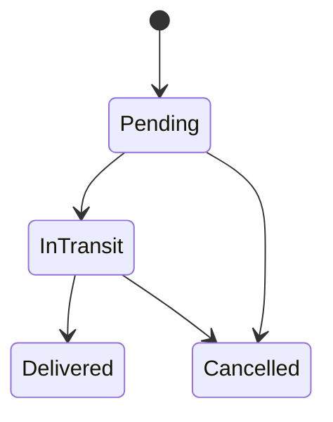
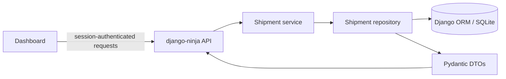

# Trace Supply

Shipment operations, from first scan to final delivery.

[](https://www.python.org/)
[](https://www.djangoproject.com/)
[](https://django-ninja.dev/)

| | Link |
| --- | --- |
| Project source | [GitHub repository](https://github.com/bhuvneshkumarprajapati/trace-supply) |
| Public dashboard | [https://trace-supply.onrender.com/](https://trace-supply.onrender.com/) |
| Public API explorer | [https://trace-supply.onrender.com/api/docs](https://trace-supply.onrender.com/api/docs) |
| Local dashboard | [http://127.0.0.1:8000/](http://127.0.0.1:8000/) |
| Local API explorer | [http://127.0.0.1:8000/api/docs](http://127.0.0.1:8000/api/docs) |

> The dashboard requires an account. Render's free web service spins down after 15 minutes of inactivity, so the first request can take about a minute. The free PostgreSQL database expires after 30 days.

## What It Does

Trace Supply provides a session-authenticated operations dashboard for registering shipments, filtering the movement log, recording handoffs, and reviewing a shipment's event timeline. A read-only tracking endpoint can be queried by shipment ID.

### Dashboard

- Shipment totals by status, searchable register, and status filters
- Create shipments with origin and destination
- Record valid status transitions with location and notes
- Inspect time-ordered shipment history
- Responsive layout for desktop and mobile

### Status Flow



Delivered and cancelled shipments are terminal states. Every status change is recorded as a separate shipment event.

## Quick Start

Requirements: Python 3.13+ and [uv](https://docs.astral.sh/uv/).

```powershell
uv sync
uv run python src/manage.py migrate
uv run python src/manage.py createsuperuser
uv run python src/manage.py runserver
```

Open [http://127.0.0.1:8000/](http://127.0.0.1:8000/) and sign in with the superuser credentials you created. The dashboard and write endpoints require an authenticated session.

## Deploy on Render

The repository includes a Render Blueprint in `render.yaml`, deployed at the public links above. It provisions the web service and PostgreSQL database, applies migrations, collects static files, and starts Gunicorn.

Free Render web services do not provide Shell access. To create the first dashboard account, copy the database's **External Database URL** from Render, then run these commands locally in PowerShell:

```powershell
$env:DATABASE_URL = "<paste the External Database URL here>"
uv run python src/manage.py createsuperuser
Remove-Item Env:DATABASE_URL
```

The URL contains database credentials. Do not commit it or share it in chat. The command connects to the deployed database and creates your admin account there.

The configured free plan is suitable for a public preview, not production. Choose paid plans for persistent database storage and an always-on service.

## API

The OpenAPI explorer is available at `/api/docs` while the server is running.

| Method | Path | Access | Purpose |
| --- | --- | --- | --- |
| `GET` | `/api/shipments/` | Authenticated | List shipments; optional `?status=pending` filter |
| `POST` | `/api/shipments/` | Authenticated | Register a shipment |
| `GET` | `/api/shipments/{shipment_id}/` | Public, read-only | Retrieve shipment and movement history |
| `PATCH` | `/api/shipments/{shipment_id}/status/` | Authenticated | Record a valid status transition |

Shipment IDs use the `shp_` prefix; movement event IDs use `evt_`.

<details>
<summary>Example API requests</summary>

Create a shipment (send with an authenticated Django session):

```json
{
	"origin": "Port of Oakland",
	"destination": "Reno distribution centre"
}
```

Update its status:

```json
{
	"status": "in_transit",
	"location": "Port of Oakland terminal",
	"note": "Loaded for dispatch"
}
```

Public tracking lookup:

```text
GET /api/shipments/shp_<shipment-id>/
```

</details>

## Architecture



The repository owns ORM access and returns DTOs. The service validates shipment rules, while API routes handle HTTP concerns. Shipment and event primary keys are prefixed ULIDs.

<details>
<summary>Project layout</summary>

```text
src/
	project/                 Django settings, API, shared services
	shipments/               Shipment models, DTOs, repository, service
	static/dashboard/        Dashboard styles and browser interactions
	templates/               Dashboard and login templates
tests/                     Repository, service, and API tests
```

</details>

## Development Checks

```powershell
uv run ruff check src tests
uv run ruff format --check src tests
uv run pyrefly check src
uv run python src/manage.py check
uv run python src/manage.py makemigrations --check --dry-run
uv run pytest
```

## Configuration

The default setup uses SQLite and does not require an environment file. Optional settings are read with `python-decouple`: `SECRET_KEY`, `DEBUG`, `ALLOWED_HOSTS`, `CELERY_BROKER_URL`, and `CELERY_RESULT_BACKEND`. Replace the development secret and configure production hosts before deployment.
